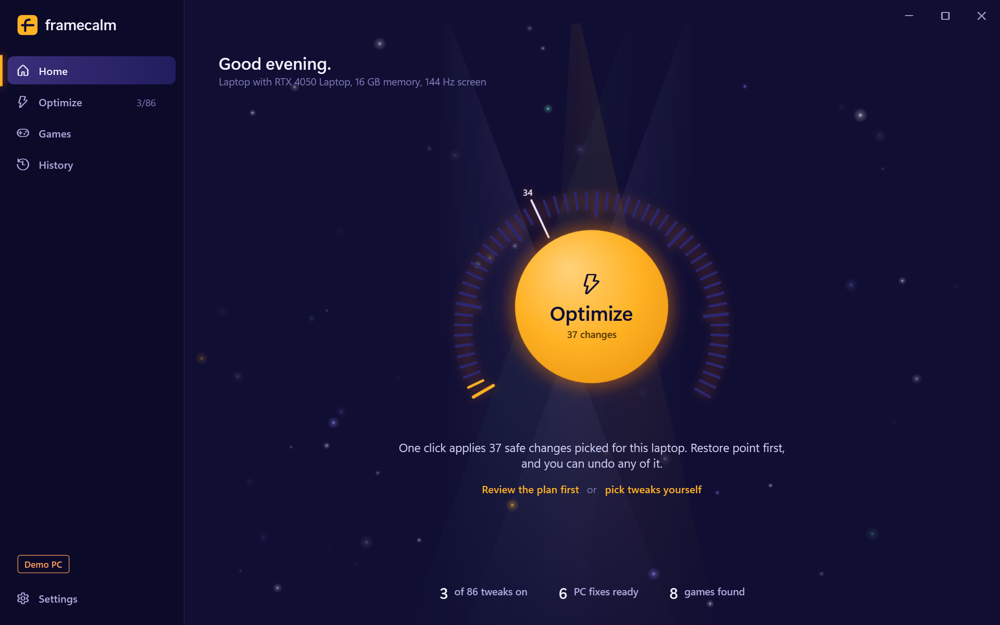

<p align="center">
  
</p>

<h1 align="center">Framecalm</h1>

<p align="center">
  <b>Tune every corner of Windows.</b><br>
  One click builds a plan for your PC, or pick from 87 power, graphics, network, input, background and privacy tweaks yourself. Every change explained, and every one can be switched back.
</p>

<p align="center">
  <a href="https://github.com/krezio/framecalm/releases/latest"></a>
  
  <a href="LICENSE"></a>
  <a href="https://framecalm.krezio.xyz"></a>
</p>

<p align="center">
  
</p>

<p align="center">
  <a href="https://github.com/krezio/framecalm/releases/latest/download/Framecalm-Setup.exe"><b>Download for Windows</b></a> &nbsp;&middot;&nbsp;
  <a href="https://framecalm.krezio.xyz">Website</a> &nbsp;&middot;&nbsp;
  <a href="https://framecalm.krezio.xyz/tweaks/">All 87 tweaks</a>
</p>

## What it does

| | |
|---|---|
| **Home** | One button. It builds a plan from the hardware (laptop or desktop, GPU, what is already set): PC fixes plus tweaks at Everyday, Competitive or All out level, each line with a reason. Laptops skip tweaks that cost battery and heat. |
| **Tweaks** | 87 tweaks in nine categories (power and CPU, graphics, network, mouse and keyboard, background apps, services, look and feel, privacy, system and security). Each one is a row with a switch, a Safe / Advanced / Extreme tier, what it does, what it costs, and the exact registry values or power settings it writes. Presets (Recommended, Competitive, Extreme) stage changes for review; nothing is written until you apply. |
| **PC fixes** | Fixes Windows gets wrong on its own: a screen running below its refresh rate, Wi-Fi adapter power saving, background recording, Game Mode, windowed-game optimizations, slow power plans. |
| **Startup apps** | Everything that starts with Windows, one switch each. |
| **Games** | Finds games in Steam, Epic, Riot, Battle.net, the Xbox app, Minecraft and Roblox. Tunes Minecraft Java, Fortnite and Rocket League settings files for your hardware; exact in-game steps for games with strict anti-cheat; pins games to the dedicated GPU on laptops. |
| **Benchmarks** | Three runs before and three after with PresentMon: average FPS, 1% lows, P95/P99 frame times and a plain verdict, plus whether the CPU or GPU is the limit. |
| **Game Session** | Fastest power plan and fewer background apps while you play, all put back when the game closes. |
| **History** | Every value changed, with the original. Undo one, a group, or everything. |

## Tiers

- **Safe**: a clear benefit and nothing you'd miss.
- **Advanced**: trades power use or a convenience for lower latency.
- **Extreme**: turns off a Windows protection or feature (Memory Integrity and VBS, Spectre/Meltdown mitigations, automatic maintenance, printing). The app asks you to confirm these.

The catalog lives in [`src/Framecalm.Windows/Data/tweaks.json`](src/Framecalm.Windows/Data/tweaks.json). The website's tweak list is generated from the same file.

## What it leaves out, on purpose

RAM cleaners, turning off Defender (Tamper Protection reverts it), HPET / dynamic tick / platform clock, TCP window and IRPStackSize "network packs", Realtime priority, deleting services. They don't help, or they cost more than they give. Framecalm never touches game files, memory, launch options or anti-cheat.

## Safety

- **Restore point first.** Before the first change that needs admin, Windows makes a restore point. One admin prompt covers the whole batch.
- **Old value saved.** Every value is journaled on disk before it is touched.
- **Written and checked.** Every value is read back. If one doesn't match, the whole batch goes back.
- **Crash-safe.** Anything left half-done by a crash or power cut is rolled back on the next start.
- **Conflicts are your call.** If something changed a value after Framecalm did, undo asks before overwriting it.
- **Main app runs without admin.** `Framecalm.ElevatedHelper` is the only elevated part. It accepts three commands (frame capture, restore point, tweak) and the tweak command refuses any key that isn't in the catalog, or any value of the wrong type.

## Privacy

No account, no ads, no telemetry. Works offline. Two things can use the network, and both have a switch in Settings: downloading each game's official cover image once from Steam or the Microsoft Store (on by default), and an update check when the app opens (you choose at first launch; switch it off in Settings).

Cover art belongs to each game's publisher. It is fetched to your PC for display, like any launcher does, and is never bundled with Framecalm or stored in this repository. With downloads off, Framecalm draws its own covers.

## Install

Grab **Framecalm-Setup.exe** (per-user, no admin needed to install) or the portable zip from [Releases](https://github.com/krezio/framecalm/releases/latest). A Microsoft Store version is on the way.

## Build it yourself

Requires the [.NET 10 SDK](https://dotnet.microsoft.com/download).

```bash
dotnet run --project src/Framecalm.App                # run it
dotnet run --project src/Framecalm.App -- --demo      # made-up laptop, nothing on your PC is read or changed
dotnet test                                           # adapter, tweak, transaction, crash-recovery and conflict tests
```

Frame capture needs `PresentMon.exe` (MIT, by Intel). Run `tools/fetch-presentmon.ps1` once: it downloads the pinned version, checks its hash, and the build copies it next to `Framecalm.exe`.

| Flag | What it does |
|---|---|
| `--demo` | A made-up gaming laptop with made-up numbers. Nothing real is read or written. |
| `--shots <dir>` | Runs the demo and saves a screenshot of every screen. |
| `--record <file.mp4> --scenario hero` | Films the demo with a scripted cursor (needs ffmpeg). |
| `--diagnose <file.txt>` | Read-only self-check: writes what Framecalm sees on this PC (hardware, games, available fixes) to a text file. |
| `--export-icon <file.ico>` | Renders the app icon. |

## Project layout

```
src/
  Framecalm.App            WPF app (MVVM), design system, screenshot and recording modes
  Framecalm.Core           models, profiles, recommender, auto-tune planner, bottleneck and stats
  Framecalm.Backups        journal, backups, verify, undo, conflicts, crash recovery
  Framecalm.Discovery      Steam, Epic, Riot, Battle.net, Xbox app, Minecraft, Roblox; hardware
  Framecalm.GameAdapters   config adapters + game profiles as validated JSON (Data/*.json)
  Framecalm.Windows        tweak catalog and engine, GPU preference, startup apps, power plans, Game Session, health
  Framecalm.Benchmarks     PresentMon runner and CSV parser
  Framecalm.ElevatedHelper the only elevated part: three allowlisted commands
  Framecalm.Demo           the simulated PC
tests/                     xunit tests with real-format fixtures
site/                      framecalm.krezio.xyz (home page generated by tools/build-site.mjs)
```

## Adding a game

Game support is data, not code: add a JSON file to `src/Framecalm.GameAdapters/Data/` with the settings file path, a format/version rule, and each setting's faster direction, profile targets, typical gain, visual cost, why it helps and what you give up. The catalog is validated at startup and in tests. Guided games only need the in-game steps.

## Contributing

Bug reports and ideas are welcome in [Issues](https://github.com/krezio/framecalm/issues). If a tweak doesn't do what it says on your PC, say which one and what you saw.

Tweaks are data: each one is an entry in [`tweaks.json`](src/Framecalm.Windows/Data/tweaks.json) with its registry values or power settings, tier, trade-off and default. The elevated helper only accepts keys listed there, and the tests check every entry. A new tweak needs a clear, measurable reason to exist.

## Credits

The app and website use [Onest](https://github.com/simpletype-co/Onest) (SIL Open Font License, see `src/Framecalm.App/Assets/Fonts/OFL.txt`). Frame capture uses [PresentMon](https://github.com/GameTechDev/PresentMon) by Intel (MIT).

## License

[MIT](LICENSE) © 2026 krezio
